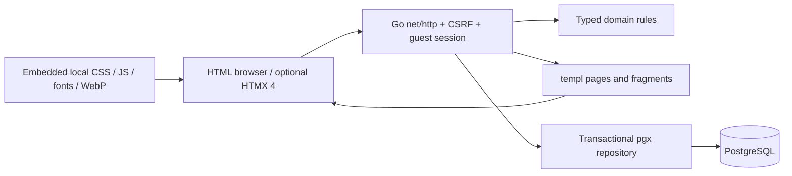

# Black Label architecture

The new runtime is one Go monolith. cmd/web owns explicit configuration, timeouts, database pool and graceful shutdown. internal/web validates requests, enforces CSRF/ownership, negotiates full/fragment HTML and gzip. internal/domain owns money, variants, capacity, query filtering and deterministic relationships. internal/database owns parameterized SQL and transaction locking. views holds typed view models and templ components.

Products, variants, media provenance, collection stories and their memberships load from PostgreSQL. For the bounded 20-product seed, search/filter/sort uses a server-side scan of database-loaded records; pagination renders 8 pieces. Larger datasets should move discovery into measured indexed SQL. There is no Redis, microservice layer, browser application runtime or frontend bundler in the Go production image.

Session-row locks serialize a guest's mutations. Active variants/shared capacity are revalidated before additions/checkout. Orders snapshot trusted prices and immutable details while clearing the bag atomically; owner+idempotency-key uniqueness handles retries. Wishlist transfers and outfit-to-bag use the same transaction boundary. Guest data is scoped by hashed opaque cookie and expires after 30 days.

HTMX 4.0.0 enhances GET filters and quick shop. All mutations use ordinary POST/Redirect/GET. HX-Request-Type=partial returns suitable fragment HTML; history/full requests receive a document. Vary separates representations. Events expose detail.ctx. Native forms still purchase without JavaScript. No version-2 event/inheritance assumptions are used.

Resources embed local CSS/JS, fonts, WebP, migrations and seeds. Authored CSS/JS URLs carry content fingerprints; HTMX uses its exact version and official SRI. Gzip covers compressible responses; guest HTML remains no-store. Original Vue assets/tests remain for regression reference and unchanged Pages, excluded from the production image. Path aliases support numeric products, /cart and /products; hash fragments require an explicitly approved old-origin strategy.

The following is the preserved baseline description, not the Go runtime.

## Legacy Vue reference (ae12cd3)

Style Ease is a static Vue storefront designed for GitHub Pages. It is intentionally front-end only: customer information, orders, catalogue stock, and saved products are simulated in the browser and never sent to a service.

## Application shape

- `src/js/app.js` owns the shared storefront instance and connects route pages through explicit props and events.
- `src/js/store/storefront.js` is the single source of truth for cart lines, wishlist variants, comparisons, recently viewed products, and demo receipts. It can replace synchronized collections without re-emitting a persistence write.
- `src/js/store/storage.js` reads and writes a versioned browser-storage snapshot. It validates malformed, outdated, unknown, and invalid-option values before they reach the interface.
- `src/js/data/catalog.js` contains the static catalogue, ratings, release dates, and fixed demonstration stock values.
- `src/js/pages/` contains route-level page modules. Routes are loaded on demand to keep the initial bundle focused on the app shell.
- `src/js/utils/catalogue-state.js` turns catalogue search, filters, sort order, and pagination into compact URL query state.

## Storefront data rules

Cart and wishlist entries are identified by product, size, and colour. Matching cart variants merge quantities, while the central store caps quantities across all variants at the static product stock value. Product prices are copied onto cart lines so a demo receipt keeps the price shown at the time of selection. The UI retains those selected options in the wishlist, cart, and the product-page toggle state, so removing one saved variant never affects another.

Browser storage is a convenience, not a user account. A saved snapshot may contain cart, compact wishlist variants, comparison, recently viewed, and receipt data, but never checkout delivery details; legacy receipts are rewritten without them when read. Reading the snapshot is defensive: invalid JSON, obsolete versions, unknown products, and unsupported product options are ignored safely. A `storage` event updates those synchronized collections in other tabs without causing write loops. Reviews are separate browser-local records, capped at 50 per product and explicitly described as non-verified demo entries.

## Routing and deployment

The app uses hash routing so bookmarked routes and refreshes work on a GitHub Pages project site. Catalogue URLs can include `q`, `category`, `size`, `color`, `price`, `inStock`, `sort`, and `page` query values. Unknown routes render an accessible recovery screen, while invalid product IDs keep their product-specific screen. Lazy-route failures surface a Retry UI and allow one session-guarded reload before relying on an explicit retry. The Vite production base remains `/style-ease/`, matching the GitHub Pages project path.

GitHub Actions installs with `npm ci`, runs `npm run validate` (including the initial JavaScript and CSS gzip budgets), builds the site, and deploys only the generated `dist/` output from `main`.

## Verification approach

The suite contains 156 unit tests across 23 files, including mounted Vue component interactions through Vue Test Utils. Six Playwright scenarios cover the production build's purchase, deep-link, route accessibility, keyboard shopping controls, and mobile flows. `npm run validate` is the local and CI quality gate: formatting, linting, tests, a production build, and bundle budgets; CI follows it with the Playwright suite.
